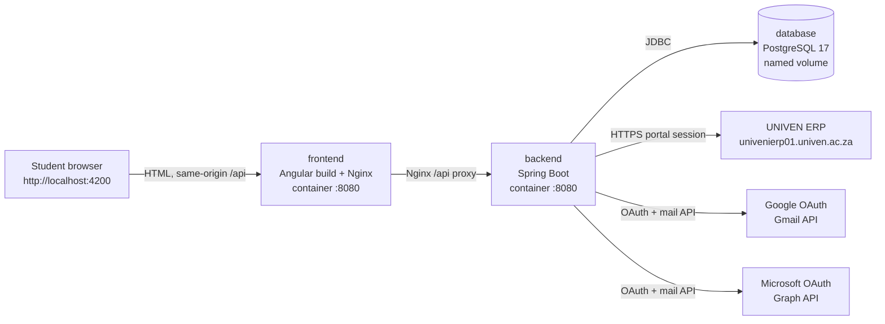
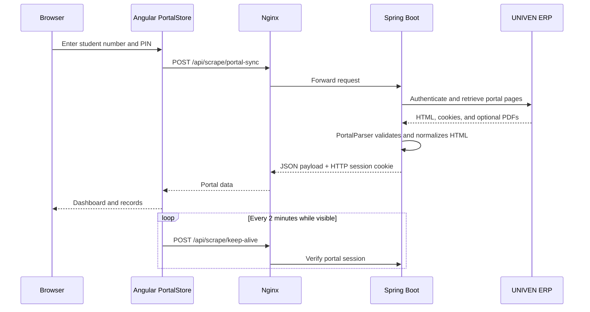
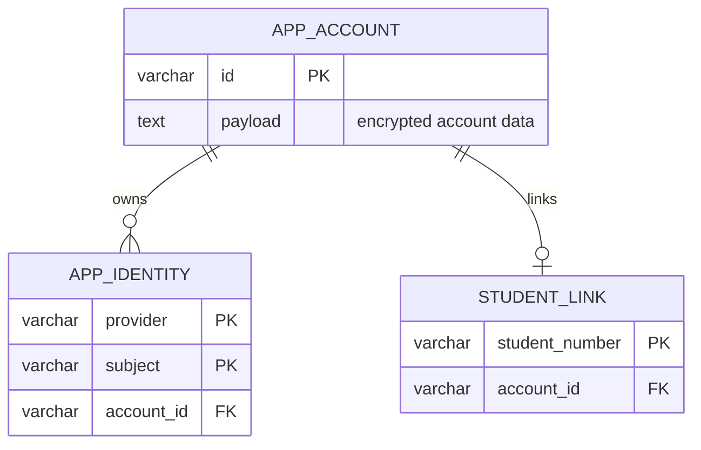

# UNIVEN Student App

Technical documentation for the Angular and Spring Boot student portal.

## 1. Purpose and Scope

This project provides a student-facing web application for:

- Signing in to the University of Venda student portal.
- Displaying profile, academic, financial, residence, registration, and result data returned by the portal.
- Connecting a Gmail or Microsoft account for ICT support communication.
- Creating, replying to, and refreshing support tickets.
- Exporting selected statement and result information as client-side PDFs.
- Streaming official proof documents from the university portal.

The project is a portal integration, not an independent university-record system. The backend maintains a temporary authenticated portal session and parses the upstream portal's HTML. Changes to the upstream portal's URLs, labels, tables, cookies, or response formats can therefore affect the application.

## 2. Architecture Overview

The production-shaped local stack contains three services:



### Request routing

- The browser only needs the published frontend address: `http://localhost:4200`.
- Nginx serves the compiled Angular application.
- Nginx forwards `/api/` requests to the Compose service named `backend`.
- The backend is not published directly by `compose.yaml`.
- During Angular development, `proxy.conf.json` forwards `/api/**` to `127.0.0.1:8080`.
- PostgreSQL is available to the backend using the Compose DNS name `database`, not `localhost`.

### Login and portal data flow



### Support account flow

1. Angular opens a provider popup by calling `POST /api/account/start`.
2. The backend creates an OAuth state and PKCE transaction.
3. The provider redirects to `GET /api/account/callback`.
4. The backend validates the callback, stores encrypted provider/account data, and signals the opener window.
5. Angular reloads `/api/account/session` and can refresh or send tickets.
6. `MailService` uses Gmail or Microsoft Graph to send messages and retrieve replies.

## 3. Repository Structure

```text
univen-anguler-app/
|-- compose.yaml                    Docker Compose services and volume
|-- .env.example                    Safe environment-variable template
|-- .env                            Local secrets; keep private and uncommitted
|-- clone_status.md                 Feature status and known limitations
|-- PROJECT_DOCUMENTATION.md        This document
|-- app-logo/                       Application branding assets
|-- scripts/
|   |-- backend.ps1                 Windows backend task wrapper
|   |-- setup-tools.ps1             Downloads project-local Java/Maven tools
|   `-- copy-shared.mjs              Shared asset/build helper
|-- backend/
|   |-- Dockerfile                  Multi-stage Maven/JRE image build
|   |-- pom.xml                     Maven dependencies and Java version
|   `-- src/
|       |-- main/java/za/ac/univen/clone/
|       |   |-- StudentApplication.java  Spring Boot entry point
|       |   |-- WebSecurity.java         Request security and boundary checks
|       |   |-- PortalController.java    Portal REST endpoints
|       |   |-- PortalSession.java       Per-HTTP-session portal state
|       |   |-- PortalTransport.java     Allowlisted portal HTTP client
|       |   |-- PortalParser.java         HTML parser and validation
|       |   |-- AccountController.java    OAuth and support REST endpoints
|       |   |-- AccountService.java       OAuth, encryption, and account logic
|       |   |-- AccountRepository.java    JDBC persistence
|       |   |-- MailService.java           Gmail/Graph mail operations
|       |   |-- ProviderHttp.java          Allowlisted provider HTTP client
|       |   |-- Data.java                  JSON/data helpers
|       |   `-- ApiProblem.java            Typed API errors
|       |-- main/resources/
|       |   |-- application.properties  Runtime configuration
|       |   `-- schema.sql               Account and student-link schema
|       `-- test/java/...               Parser and boundary tests
|-- frontend/
    |-- Dockerfile                    Node build + unprivileged Nginx runtime
    |-- nginx.conf                    Static hosting, security headers, API proxy
    |-- package.json                  Angular and test dependencies/scripts
    |-- angular.json                  Angular build and serve configuration
    |-- proxy.conf.json               Dev-server API proxy
    |-- playwright.config.ts          Desktop/mobile E2E projects
    |-- e2e/                          Playwright tests
    `-- src/
        |-- main.ts                   Angular bootstrap
        |-- styles.css                Global styles
        `-- app/
            |-- app.component.*       Main shell, tabs, dialogs, dashboard
            |-- login.component.*     Login screen and validation
            |-- portal.store.ts        Signals, API client, session state
            |-- records.component.ts   Portal records/residence view
            |-- account.component.ts   Email provider connection
            |-- requests.component.*   Support ticket list/detail UI
            |-- call.component.ts      New support call form
            |-- catalog.ts             Services directory data
            |-- types.ts               Shared frontend types
            `-- shared/                Icons, modal, categories, exports, normalizers
```

## 4. Frontend Design

The Angular application uses standalone components and does not use Angular Router. `app.component.ts` owns the primary view state and switches between the dashboard, services, call form, requests, and profile views. Dialogs are opened from the shell for records and documents.

`PortalStore` is the frontend boundary for backend communication. It:

- Uses Angular signals for portal data, account data, tickets, notices, and busy states.
- Sends same-origin `fetch` requests under `/api/` with session credentials.
- Uses a 90-second request timeout.
- Clears portal data when a portal request receives HTTP 401.
- Pings the backend every two minutes while portal data exists and the document is visible.
- Persists only ticket read timestamps in `localStorage`.
- Does not persist the student PIN or portal cookies in the browser.

### Frontend dependencies

Runtime dependencies from `frontend/package.json`:

| Dependency | Purpose |
|---|---|
| Angular 21 packages | Standalone UI framework, forms, browser bootstrap |
| Angular CDK 21 | UI utilities |
| RxJS 7.8 | Reactive support used by Angular ecosystem |
| `jspdf` | Client-side PDF generation |
| `jspdf-autotable` | Tables in generated PDFs |
| `tslib` | TypeScript runtime helpers |

Development dependencies include Angular CLI/build/compiler, TypeScript 5.9, Tailwind CSS 4, PostCSS, and Playwright 1.56.

## 5. Backend Design

The backend is a Spring Boot 4.1.1 application running on Java 21.

### Portal integration

- `PortalController` exposes the portal-facing API.
- `PortalSession` holds the authenticated upstream portal cookies and student number in the server-side HTTP session.
- `PortalTransport` performs restricted HTTPS calls to the configured UNIVEN portal host.
- `PortalParser` converts portal HTML into structured JSON and deliberately rejects unexpected table/header layouts instead of silently returning incorrect records.
- Official PDFs are retrieved from the portal and streamed as `application/pdf`.

Portal sessions are in memory. A backend restart invalidates active portal logins. The browser must sign in again after a restart.

### Account and mail integration

- `AccountController` exposes OAuth and ticket endpoints.
- `AccountService` handles provider configuration, OAuth state, PKCE, token verification/refresh, account linking, and encrypted account payloads.
- `AccountRepository` stores encrypted account data and provider identities with JDBC.
- `MailService` sends and retrieves support messages through Gmail or Microsoft Graph and normalizes them into tickets.
- `ProviderHttp` restricts outbound provider requests.

### Backend dependencies

| Dependency | Purpose |
|---|---|
| Spring WebMVC | REST controllers and HTTP responses |
| Spring Security | Request/security boundary configuration |
| Spring Actuator | Health endpoint and readiness probes |
| Spring JDBC | Database access |
| Spring Security OAuth2 JOSE | JWT/JWKS and OAuth token-related support |
| H2 | Default file-backed local database runtime |
| PostgreSQL driver | Compose/production database runtime |
| Jsoup 1.21.2 | Portal HTML parsing |
| Jackson Databind 2.20.1 | JSON processing |
| Spring Boot Test | Backend tests |

## 6. System API Reference

All application endpoints are under `/api`. Requests that need a body use JSON. Browser session cookies are used for authentication; the frontend sends them with same-origin credentials.

### Portal endpoints

| Method | Endpoint | Description |
|---|---|---|
| POST | `/api/scrape/portal-sync` | Validate `unum`, `pin`, and optional `numtype`; authenticate against the portal and create the server-side portal session. |
| POST | `/api/scrape/logout` | Revoke the upstream portal session and remove it from the HTTP session. |
| POST | `/api/scrape/keep-alive` | Verify that the current portal session is still valid. |
| POST | `/api/scrape/link-account` | Link the signed-in student number to the connected support account. |
| GET | `/api/scrape/read/{section}` | Read supported portal sections such as `admission`, `results`, `contacts`, `documents`, `residenceApplications`, or `progress`. |
| GET | `/api/scrape/proof-status` | Check availability of proof of registration and return its stream URL. |
| GET | `/api/scrape/proof-pdf` | Stream proof of registration inline, or download it when `?download=1` is supplied. |
| GET | `/api/scrape/residence-proof-pdf` | Download residence proof for the current portal session. |

The backend rejects attempts to pass `unum` or `pin` to a read endpoint. Credentials are accepted only by the login endpoint.

### Account and support endpoints

| Method | Endpoint | Description |
|---|---|---|
| GET | `/api/account/session` | Return the current account summary and whether Google/Microsoft providers are configured. |
| POST | `/api/account/start` | Start OAuth. Body includes `provider` and optional `link`. Returns an authorization URL. |
| GET | `/api/account/callback` | Complete OAuth and return a small callback page that signals the opener window. |
| POST | `/api/account/logout` | Remove account and OAuth state from the HTTP session. |
| POST | `/api/account/tickets/refresh` | Retrieve and normalize current support history. |
| POST | `/api/account/tickets/send` | Send a new support ticket. |
| POST | `/api/account/tickets/reply` | Send a reply to an existing ticket. |

### Operational endpoint

| Method | Endpoint | Description |
|---|---|---|
| GET | `/actuator/health` | Liveness/readiness health response. Details are hidden. |

Only the health actuator endpoint is exposed. Environment and other actuator endpoints are intentionally not exposed.

## 7. Database and Persistence

`backend/src/main/resources/schema.sql` is run automatically at startup.



Tables:

- `app_account`: one encrypted payload per support account.
- `app_identity`: maps an OAuth provider and provider subject to an account.
- `student_link`: uniquely maps a student number to one account.

Outside Docker, the default is file-backed H2 at `./.data/accounts`. Compose supplies PostgreSQL 17 through `DATABASE_URL`, and the named `database` volume stores its data at `/var/lib/postgresql/data`.

## 8. Configuration Reference

Create `.env` from `.env.example`. Do not commit `.env`, OAuth client secrets, database passwords, or account encryption keys.

| Variable | Required | Description |
|---|---:|---|
| `APP_ORIGIN` | Yes | Browser origin used for origin checks and OAuth redirect construction. Local default: `http://localhost:4200`. |
| `APP_ACCOUNT_KEY` | Yes for support accounts | Base64-encoded 32-byte key used to encrypt account payloads. |
| `DATABASE_PASSWORD` | Yes in Compose | PostgreSQL password for the `univen` database user. |
| `COOKIE_SECURE` | No | Set `true` when the app is served over HTTPS. Keep `false` for plain local HTTP. |
| `GOOGLE_CLIENT_ID` | Optional | Google OAuth client ID for Gmail support. |
| `GOOGLE_CLIENT_SECRET` | Optional | Google OAuth client secret. |
| `MICROSOFT_CLIENT_ID` | Optional | Microsoft Entra application client ID. |
| `MICROSOFT_CLIENT_SECRET` | Optional | Microsoft Entra application secret. |
| `MICROSOFT_TENANT_ID` | Optional | Microsoft tenant ID, used for the provider authority. |

The backend also accepts these direct Spring environment variables when running outside Compose:

| Variable | Default | Purpose |
|---|---|---|
| `DATABASE_URL` | `jdbc:h2:file:./.data/accounts;DB_CLOSE_ON_EXIT=FALSE` | JDBC connection URL |
| `DATABASE_USER` | `sa` | Database user |
| `PORT` | `8080` | Backend HTTP port |
| `SERVER_ADDRESS` | `127.0.0.1` | Backend bind address |

Generate a new account key in PowerShell with a local Java or OpenSSL installation. For example, using OpenSSL:

```powershell
openssl rand -base64 32
```

The output must be a valid base64 encoding of exactly 32 bytes. Treat it as a secret and do not replace an existing production key casually, because doing so makes previously encrypted account payloads unreadable.

## 9. Docker Setup

### Prerequisites

Install:

- Docker Desktop for Windows with the Linux container engine enabled.
- Docker Compose v2, included with current Docker Desktop releases.
- Git if cloning the repository.

Verify Docker:

```powershell
docker --version
docker compose version
docker info
```

### First-time setup

From the repository root:

```powershell
Copy-Item .env.example .env
```

Edit `.env` and set at least:

```dotenv
APP_ORIGIN=http://localhost:4200
APP_ACCOUNT_KEY=<base64-encoded-32-byte-key>
DATABASE_PASSWORD=<local-database-password>
COOKIE_SECURE=false
```

OAuth variables may remain empty while portal records are being tested. Gmail/Microsoft support connection requires correctly configured provider applications, redirect URIs, scopes, and credentials.

### Build and start the full stack

```powershell
docker compose up --build
```

Open `http://localhost:4200`. The frontend container is bound to loopback only, so it is not exposed to other network interfaces by default.

To start in the background:

```powershell
docker compose up --build -d
```

### Inspect and operate services

```powershell
# Show service state
docker compose ps

# Follow all logs
docker compose logs -f

# Follow one service
docker compose logs -f backend
docker compose logs -f frontend
docker compose logs -f database

# Restart one service
docker compose restart backend

# Rebuild one image
docker compose build backend
docker compose build frontend

# Stop containers but keep the database volume
docker compose down

# Stop containers and delete the PostgreSQL data volume
docker compose down -v
```

`docker compose down -v` is destructive for locally stored account data. Use it only when intentionally resetting the database.

### Compose startup order

1. PostgreSQL starts and runs `pg_isready -U univen -d univen` every five seconds.
2. Compose starts the backend after PostgreSQL reports healthy.
3. The backend initializes the schema and listens on container port `8080`.
4. The frontend starts Nginx on container port `8080` and proxies `/api/` to `backend:8080`.

Compose does not define a backend healthcheck, so frontend container startup does not prove that the backend is ready. Nginx will return an upstream error briefly if the backend is still starting; retry the browser request or inspect backend logs.

### Docker image details

Backend `Dockerfile`:

1. Uses Maven with Eclipse Temurin 21 to compile and test the JAR.
2. Uses a smaller Temurin 21 JRE Alpine runtime image.
3. Creates and runs as the unprivileged `portal` user.
4. Sets `SERVER_ADDRESS=0.0.0.0` so the service is reachable inside the Compose network.

Frontend `Dockerfile`:

1. Uses Node 22 Alpine for the Angular build.
2. Runs `npm ci` using the lock file.
3. Runs `npm run build`.
4. Copies `dist/univen/browser` into unprivileged Nginx.
5. Listens on port `8080`.

## 10. Local Development Without Docker

### Frontend only

```powershell
Set-Location frontend
npm install
npm start
```

The Angular dev server runs at `http://localhost:4200` and uses `proxy.conf.json` for `/api` calls.

### Backend with project-local tools

The helper scripts can download Java 21 and Maven 3.9.11 into `.tools` without changing the system PATH:

```powershell
.\scripts\setup-tools.ps1
```

Then run backend tasks from the repository root:

```powershell
.\scripts\backend.ps1 -Task verify
.\scripts\backend.ps1 -Task run
.\scripts\backend.ps1 -Task package
```

`backend.ps1` loads values from `.env`, prefers the project-local tools, and executes Maven in `backend/`.

For a system-installed Java 21 and Maven:

```powershell
Set-Location backend
mvn -B -ntp verify
mvn -B -ntp spring-boot:run
```

When running the backend locally with the default properties, it binds to `127.0.0.1:8080` and uses file-backed H2. Run Angular in a second terminal so its dev proxy can reach the backend.

## 11. Tests and Build Verification

### Backend tests

```powershell
.\scripts\backend.ps1 -Task verify
```

The backend tests cover parser contracts, changed portal columns, hidden-field handling, menu parsing, financial values, host allowlisting, MIME/header safety, trusted senders, health response redaction, origin checks, invalid input, missing sessions, account requirements, and actuator restrictions.

### Frontend production build

```powershell
Set-Location frontend
npm ci
npm run build
```

### End-to-end tests

```powershell
Set-Location frontend
npx playwright install
npm run test:e2e
```

Playwright runs desktop Chrome and an iPhone 13 emulation project. The Playwright web server starts `npm.cmd start` automatically when the frontend is not already running. The tests use mocked API responses for most UI workflows, so they do not prove live portal, OAuth, mail-provider, or production PostgreSQL behavior.

## 12. Security and Operational Notes

- Keep `.env` private. If a real OAuth secret or encryption key is exposed, rotate it in the provider and replace the local value.
- Use a unique random `APP_ACCOUNT_KEY` per environment. Losing or changing it prevents decryption of existing account payloads.
- Set `COOKIE_SECURE=true` behind HTTPS. Do not set it for ordinary local HTTP or the browser will not send the session cookie.
- Keep `APP_ORIGIN` aligned with the actual browser origin. An origin mismatch is intentionally rejected.
- The session cookie is HTTP-only, SameSite Lax, and has a default 12-hour server-side session timeout.
- The Nginx configuration adds CSP, frame, content-type, referrer, and permissions headers and limits request bodies to 3 MB.
- Backend and frontend containers run as non-root users where configured by their images.
- The backend intentionally exposes only `/actuator/health`.
- Portal session cookies are held server-side and disappear when the backend restarts.
- Contact edits shown in the UI are session-only and do not update official university records.
- Official proof PDFs come from the upstream portal. Statements and result exports are generated in the browser.

## 13. Troubleshooting

### `docker compose` reports a missing variable

Confirm `.env` exists in the repository root and contains non-empty `DATABASE_PASSWORD` and `APP_ACCOUNT_KEY` values. Compose reads `.env` from the directory containing the command unless an alternative environment file is supplied.

```powershell
docker compose config
```

This renders the resolved Compose configuration and is useful for finding interpolation errors. Do not paste its output into public issue reports if it contains secrets.

### Frontend loads but API calls fail

Check service state and logs:

```powershell
docker compose ps
docker compose logs --tail=200 backend
docker compose logs --tail=200 frontend
```

The backend is intentionally not published on the host. Test through `http://localhost:4200`, not `http://localhost:8080`, when using Compose.

### PostgreSQL is unhealthy

```powershell
docker compose logs database
docker compose exec database pg_isready -U univen -d univen
```

If the local database is disposable and its credentials/configuration are inconsistent, reset it with `docker compose down -v` and start again. This deletes local account data.

### OAuth callback fails

Verify that:

1. `APP_ORIGIN` exactly matches the URL used in the browser.
2. The provider application has the callback URL configured for `/api/account/callback` on that origin.
3. Client ID, secret, tenant, scopes, and provider API permissions are correct.
4. The browser allows the OAuth popup.

### Portal records or PDFs fail

The upstream ERP must be reachable and the student credentials must be valid. The parser intentionally fails closed when expected portal HTML changes. Check backend logs for the reference associated with the API error, then verify the upstream portal response and parser contract.

### Session disappears after restart

This is expected. Portal authentication state is kept in the backend HTTP session and is not persisted. Sign in again after restarting the backend container.

## 14. Useful Command Summary

```powershell
# Full Docker workflow
Copy-Item .env.example .env
docker compose config
docker compose up --build -d
docker compose ps
docker compose logs -f
docker compose down

# Local backend workflow
.\scripts\setup-tools.ps1
.\scripts\backend.ps1 -Task verify
.\scripts\backend.ps1 -Task run

# Local frontend workflow
Set-Location frontend
npm ci
npm start
npm run build
npm run test:e2e
```

## 15. Known Limitations

- Live portal login depends on external ERP availability and valid student credentials.
- Portal scraping is coupled to upstream HTML and endpoint contracts.
- Gmail and Microsoft support features require external OAuth configuration.
- Automated frontend tests mock backend interactions.
- The backend has no Compose healthcheck, so frontend startup can precede backend readiness.
- The current Compose file publishes the frontend on loopback and is intended for local development or controlled environments; production deployment still needs TLS, secret management, backups, monitoring, and an external database strategy.
